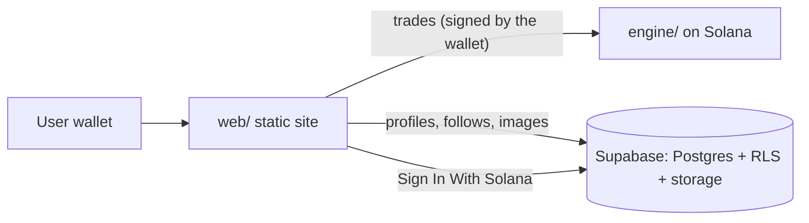

# Handoff: public site, users, and open source

This file describes how MTL Minted can run as a live product with users while the repo stays public. Use it as the plan when work on the web side starts. Finish the engine first.

Tracking issue: see the "Plan: public site and users" issue on GitHub.

## The main idea

Open-source code does not expose the live system. People can read how the system works, but they cannot use your keys or read your data.

| Public (in this repo) | Private (never in this repo) |
|---|---|
| Frontend code (browsers download it anyway) | Program upgrade authority keypair |
| Engine code (the deployed program is public on-chain anyway) | Platform wallet private key |
| Database schema and access rules (migrations) | Supabase service key and database password |
| CI workflows | Live user data |
| Mock data for local development | Paid RPC keys, deploy tokens (GitHub secrets or host settings) |

Security comes from the rules that run on the server and on-chain, not from hidden code:
- The engine checks signers, PDAs, and the fee address on-chain.
- Supabase Row Level Security checks every database read and write.
- Keys stay in GitHub secrets or in the hosting provider's settings.

If the system is safe only when nobody can read the code, it is not safe. Attackers can already read the program bytecode and the frontend JavaScript. Bluesky, Mastodon, Cal.com, and Supabase all run live products from public repos.

Keep things in a private place only if they are operations details: spam rules, admin tools, or production config. Put them in host settings or a small private repo.

## Architecture

- **Users are wallets.** No email or password. Users sign a short message to prove they own the wallet (Sign In With Solana).
- **Money stays on-chain only.** Token balances, trades, and fees are in the engine. The database never stores them, so a database bug cannot lose funds.
- **Social data is off-chain:** display name, bio, avatar, follows, friends.

## Plan

### Step 1: Public demo site (small)
- Deploy `web/` to GitHub Pages from CI on every merge to `main`.
- Fix SPA routing: copy `index.html` to `404.html` in the build, or use `HashRouter`.
- Set the Vite `base` to `/solana/`, or use a custom domain.
- The site uses mock data, so it is safe to publish now.

### Step 2: Data module (small, needs no backend yet)
- Add `web/src/data/index.js` with functions such as `getProfile(wallet)`, `updateProfile(...)`, `listArtists()`, `follow(wallet)`. They return mock data at first.
- Pages call only `web/src/data/` and `web/src/engine/`. They do not import `mock.js` directly.

### Step 3: Supabase (when real social features start)
- Add `supabase/` at the repo root with `migrations/` (tables and RLS policies) and `seed.sql`.
- Contributors run `supabase start` (local Docker) or keep the mock data. They never use the live project.
- Use wallet sign-in only. Link each profile row to a wallet address. Example RLS rule: "a user can update only the row where `wallet = auth wallet`".
- The live project URL and the anon key go in host environment variables (`VITE_SUPABASE_URL`, `VITE_SUPABASE_ANON_KEY`). The anon key is designed to be public. The service key is never used in the frontend.

### Step 4: Devnet staging (after the engine work)
- Add a manual GitHub workflow that deploys the program to devnet. The deploy keypair is a GitHub secret, and only this workflow can read it.
- The site selects the cluster with `VITE_RPC_URL`.

### Step 5: Mainnet (last)
- Do a review or an audit of the engine first.
- Move the upgrade authority to a multisig (Squads).
- Publish a verifiable build, so anyone can check that the on-chain program matches this repo.
- Use an RPC key that is locked to your domain.

## Rules to keep

- Do not commit `.env` files, keypairs, or service keys. `.gitignore` already ignores `.env`.
- Each piece stays behind one module: `web/src/engine/` for the chain and `web/src/data/` for the database.
- Mock data must keep working, so new contributors can run `web/` with no accounts.
