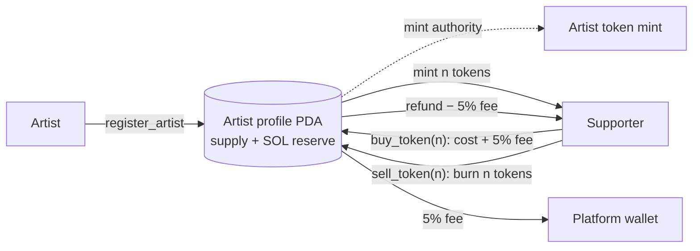

# MTL Minted

[](https://github.com/zaifnatra/solana/actions/workflows/ci.yml)

An open-source artist discovery and token experiment. The web app connects to a Rust paper-trading service: discover artists, trade with practice funds, follow releases, and create an artist profile. The separate Solana Anchor engine is available for local-validator development.

**The hosted app is paper trading.** Connecting a wallet does not send transactions or move real SOL. Paper account access is saved in the browser; clearing its storage loses access.

We built the first version at McHacks 13, and it won the MLH Solana challenge. We wanted a way for fans to back artists without turning art into a pump-and-dump. This repo is the cleaned-up version, and we work on it for fun.

## How the engine works

The engine is an Anchor program in `engine/`. Each artist has a profile account (a PDA) that holds the token supply and a SOL reserve, and controls the artist's token mint.



- The price of the next token is `0.001 SOL × supply`.
- Buying `n` tokens costs the area under that line: `0.001 × ((s + n)² − s²) / 2` SOL. The cost goes into the reserve.
- Selling refunds the same area, so the reserve always covers every token in circulation.
- A 5% fee on each trade goes to a fixed platform wallet. The program rejects any other fee address.

The curve math is in `engine/programs/sol_proj/src/curve.rs`. It is plain Rust with unit tests, so you can change it without a validator.

## Repository layout

| Folder | What it is |
|---|---|
| `engine/` | The Anchor program (Rust). |
| `staging/` | A test dashboard and a scenario runner. They run the real engine on a local validator. |
| `web/` | React app with persistent paper trades, portfolios, profiles, artist pages, follows, and release feeds. API calls live in `web/src/engine/index.js`. |
| `service/` | Rust/Axum API and SQLite persistence, reusing the engine’s integer curve math. |
| `deploy/` | TLS gateway, backup/restore tools, and operational checks. |

## Run it

With Docker Engine and Compose v2:

```bash
# Development: Vite + Rust rebuild watcher, isolated persistent data
make dev
# Open http://localhost:5173

# Production-style local build, served at http://localhost:8080
make up
```

Without Docker, use Node 24 and Rust 1.100.0. In separate terminals:

```bash
# Rust API at http://127.0.0.1:8080
cd service && cargo run --locked

# Vite proxies the API to the Rust service
cd web && npm ci && npm run dev
```

Try Buy on an artist card to create a practice account. Orders have a preview,
explicit confirmation, and persistent receipts. Wallet shows actual paper
holdings. Me lets you edit your profile, create a paper artist market, and publish
releases; follow artists to see their updates in Friends.

The on-chain engine is a separate development flow requiring Solana CLI 2.3.x
and Anchor 0.32.1:

```bash
cd engine && cargo test
cd staging && npm ci && npm run e2e
# Or open the local-validator dashboard:
cd staging && npm run up
```

The engine scenario runs seeded trades and checks that the reserve returns to its
rent minimum after everyone sells. See the staging scripts for seed/trade options.

## Deploy

Use a single persistent host for SQLite. A new DigitalOcean Droplet with Compose
is the proposed starting point; see the [cost and sizing plan](docs/DIGITALOCEAN_PLAN.md)
and [deployment, upgrades, and recovery](docs/DEPLOYMENT.md).

CI prepares multiarchitecture GHCR images with build provenance and SBOMs.
Publishing is a deliberate release/manual action. Production pulls a pinned image
digest and stores SQLite in a persistent volume. Configure a domain, TLS, backups,
and monitoring before public use. No cloud resources are created by this repo.

See the [API reference](docs/API.md) and [architecture](docs/ARCHITECTURE.md).

## Contributing

See [CONTRIBUTING.md](CONTRIBUTING.md). CI checks Rust, the web build, container health, browser flows, backup recovery, and the separate engine scenario.

## What's next

- Add explicit on-chain settlement through a generated IDL client, with wallet-signature and devnet testing.
- Add recoverable authentication before paper accounts need to survive browser storage loss.
- Tune the curve and lower compute units, using `staging/` to measure.
- Partner with Montreal artists.

## Credits

- Background video (`web/public/images/background.mp4`) by xtalcalx.
- Artist names and photos in `web/` are demo placeholders. They belong to their owners.

## License

[MIT](LICENSE). The background video and the artist photos are not covered. See Credits.
