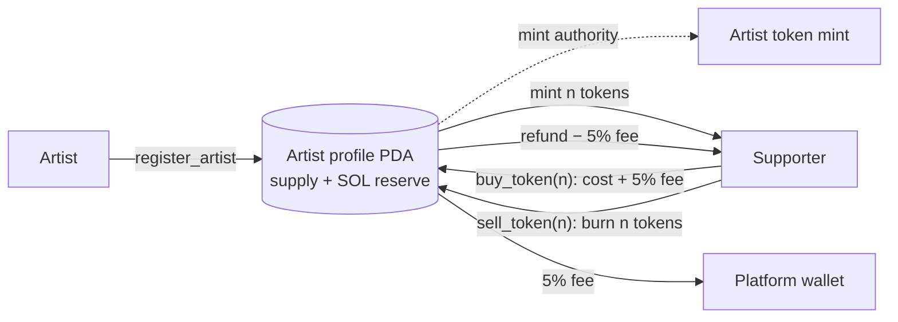

# MTL Minted

[](https://github.com/zaifnatra/solana/actions/workflows/ci.yml)

Artist tokens on Solana. An artist launches a token, and fans buy it to support them. The price follows a bonding curve, so every token can always be sold back to the artist's reserve.

We built the first version at McHacks 13, and it won the MLH Solana challenge. We wanted a way for fans to back artists without turning art into a pump-and-dump. This repo is the cleaned-up version, and we work on it for fun sparingly.

## How the engine works

The engine is an Anchor program in `engine/`. Each artist has a profile account (a PDA) that holds the token supply and a SOL reserve, and controls the artist's token mint.



- The price of the next token is `0.001 SOL × supply`.
- Buying `n` tokens costs the area under that line: `0.001 × ((s + n)² − s²) / 2` SOL. The cost goes into the reserve.
- Selling refunds the same area, so the reserve always covers every token in circulation.
- A 5% fee on each trade goes to a fixed platform wallet. The program rejects any other fee address.

The curve math is in `engine/programs/sol_proj/src/curve.rs`. It is plain Rust with unit tests, so you can change it without a validator.

## Repository layout

| Folder | What it is |
| --- | --- |
| `engine/` | The Anchor program (Rust). |
| `staging/` | A test dashboard and a scenario runner. They run the real engine on a local validator. |
| `web/` | The React app that users see. It uses mock data and is not connected to the engine yet. Its only link to the engine is `web/src/engine/index.js`. |

## Run it

You need Node 20 or later. For the engine you also need Rust, the [Solana CLI](https://solana.com/docs/intro/installation) (2.3.x), and Anchor 0.32.1.

```bash
# Frontend
cd web && npm install && npm run dev

# Curve unit tests
cd engine && cargo test

# Full engine test: build, start a fresh validator, run 50 random trades, check solvency
cd staging && npm run e2e

# Same setup, but opens the staging dashboard at http://localhost:5174
cd staging && npm run up
```

`npm run e2e` exits with `0` if every trade succeeds and the reserve returns to exactly the rent minimum after everyone sells. It also prints the compute units for each instruction, so you can compare two versions of the engine. Use `npm run e2e -- --seed 7 --trades 200` to change the run.

## Contributing

See [CONTRIBUTING.md](CONTRIBUTING.md). CI runs the web build and the full engine e2e test on every pull request.

## What's next

- Connect `web/` to the engine with a client generated from the IDL.
- Tune the curve and lower compute units, using `staging/` to measure.
- Partner with Montreal artists.

## Credits

- Background video (`web/public/images/background.mp4`) by xtalcalx.
- Artist names and photos in `web/` are demo placeholders. They belong to their owners.

## License

[MIT](LICENSE). The background video and the artist photos are not covered. See Credits.
