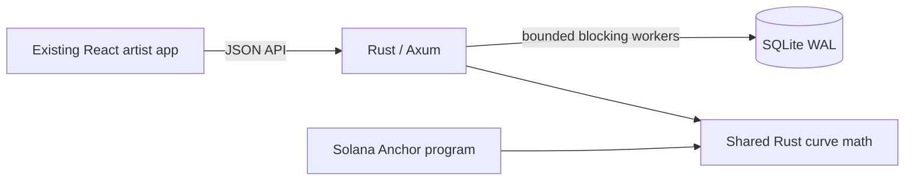

# Architecture



The deployed service is a single Rust binary. It serves both the built frontend and
API. The React frontend keeps the original artist-card design while using the
service for paper execution, profiles, artist metadata, following, and releases.
Pricing, balance checks, fees, authorization, and persistence live in Rust.
There is no Node server.

`service/src/lib.rs` includes the pure curve source from the existing Anchor
program. The service does not call Solana or impersonate a wallet. The original
`engine/` and `staging/` remain the separate on-chain development path.

## Transaction boundary

An order opens an SQLite `IMMEDIATE` transaction, authenticates the caller, checks
for an existing idempotency key, validates the deadline, recalculates the quote,
checks price and balance limits, updates cash/holdings/supply/reserve, appends the
receipt, and commits. Any pre-commit failure rolls back all updates. The unique
`(account_id, idempotency_key)` constraint is a second line of duplicate protection.

One connection is guarded by a mutex. SQLite work runs on blocking workers, with a
64-slot admission semaphore. This intentionally serializes execution for a small
self-hosted service. It is not a distributed matching engine. SQLite WAL, full
synchronous writes, a busy timeout, foreign keys, and check constraints protect
stored state. Migrations are transactional and versioned with `user_version`.

## Accounting

For every market, reserve equals the curve area from zero to current supply.
Circulating supply equals aggregate holdings. Across accounts and markets:

```
issued paper SOL = account cash + market reserves + recorded trade fees
```

Fees are retained in the immutable trade ledger; there is no withdrawal API. Buy
and sell calculations use checked integer math from the engine, never floating
point. Market and account caps keep SQLite integers and browser numbers in range.
Tests exercise round trips, competing orders, rollback, isolation, persisted
idempotency, and conservation over 200 fills.

Account holdings are valued at the current curve's hypothetical net sell refund.
These are estimates, not guaranteed future proceeds.

## Operating boundaries

- Single instance, one local durable volume. Do not place SQLite on a shared network filesystem.
- Anonymous paper accounts, bearer credentials, no real funds or custody.
- No resting limit orders, matching book, cancellations, withdrawals, or wallet integration.
- Five seeded showcase artists are explicitly demo profiles; new accounts may
  register one artist-owned paper market. Neither action creates an on-chain mint.
- Health/readiness routes and JSON logs are available; external monitoring and
  ingress abuse controls belong to the operator.
- SIGINT and SIGTERM stop accepting new requests and drain in-flight work.

Future real-money execution should use wallet-signed transactions and an audited
program, with explicit transaction confirmation and reconciliation. It requires a
separate design and security review; flipping an environment variable cannot turn
this simulator into a live exchange.

Framework references: [Axum](https://docs.rs/axum/latest/axum/),
[SQLite transactions in rusqlite](https://docs.rs/rusqlite/latest/rusqlite/struct.Connection.html#method.transaction_with_behavior).


## Creator and social state

Schema version 2 adds profiles, artist metadata/ownership, follows, and releases.
All startup migrations run within one `IMMEDIATE` transaction and a newer schema
is rejected. Existing version-1 accounts receive default profiles. The original
ECHO/MUSE/NOVA markets and their balances are preserved; five showcase markets
are inserted under distinct new symbols rather than relabeling old assets.

Anonymous artist discovery can be personalized with a bearer credential. Profile
editing is restricted to that account. Creator registration atomically inserts the
artist and zero-supply market, and a unique owner constraint limits each account
to one artist. Repeating the same registration recovers the existing result. Follow
state is an idempotent set operation scoped to account/artist. Release publication
checks ownership and optionally uses a persistent idempotency key. Feed queries
only select releases from the caller's current following list.

User-authored content is bounded plain text. Media/link URLs require HTTPS and
reject local/private literals and local hostname suffixes; the server never
fetches submitted URLs or resolves their DNS. DNS records may change, so this
syntax check does not guarantee that a hostname resolves to a public address.
Seeded profiles have no claimable owner, fabricated follows, or fabricated releases.
The API uses a 16 KiB request-body limit to accommodate bounded Unicode metadata.

## Admission and monitoring

Anonymous account creation has a process-wide 30-attempt/minute admission limit
in addition to the durable account ceiling. No forwarded client address is trusted.
A public ingress should additionally limit per-client requests; the global limiter
bounds resource use but is not an identity or comprehensive abuse-prevention system.

`/metrics` exposes aggregate account count, market count, committed trade count,
and paper reserve lamports in Prometheus format. It contains no credentials or
profile content. `/healthz` remains process liveness and `/readyz` checks storage.
