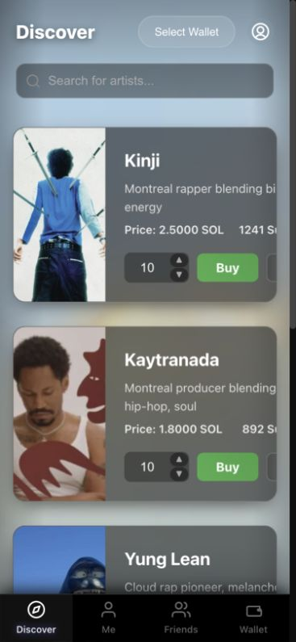

# Website walkthrough — November 26, 2026

Tested the restored site at `http://127.0.0.1:8080` in the in-app browser, at its
normal size and at explicit 375×812 and 1440×1000 viewports. The original frontend
was not edited. Screenshots and search/input results are in `qa/2026-11-26/`.

The existing visual identity should remain: cinematic video, glass artist cards,
artist photography, green buy controls, wallet pill, and four-tab navigation.
The largest gaps are execution, persistent state, artist depth, and mobile usability.

## What I exercised

| Flow | Observed result |
| --- | --- |
| Discover initial load | All five artist cards render. |
| Name search: `KINJI` | Case-insensitive matching works. |
| Genre search: `House` | Returns Kaytranada. |
| Handle search: `@blue_sax` | Returns Blue Note. |
| Unknown artist | Shows the no-results message. |
| Search: ` Kinji ` | Incorrectly shows no results; query is not trimmed. |
| Clear search | Restores all five artists. |
| Click artist name/card | No artist detail opens. |
| Quantity increment/decrement | 10 → 11 → 10 works; decrement at zero stays zero. |
| Buy 10, disconnected | Reports `Bought 10 shares!` without a wallet or confirmation. |
| Buy zero | Reports `Bought 0 shares!`. |
| Buy negative quantity | Reports `Bought -5 shares!`. |
| Buy fractional quantity | Reports `Bought 1.5 shares!`. |
| Buy blank quantity | Reports success with no quantity. |
| Sell 1,000,000 Blue Note tokens | Reports success despite no Blue Note holding. |
| Wallet after buying Kinji | Still shows the fixed 50 Kinji and 120 Kaytranada. |
| Reload Wallet | Those same fixed balances remain. |
| Click a Wallet artist | No detail or management action opens. |
| Return to Discover after a trade | Confirmation message disappears; there is no receipt/history screen. |
| Select Wallet | Opens the Phantom/Solflare picker. Escape dismisses it. |
| Me / creator profile | Shows hardcoded Test Creator, a launch button, and an NFT/badge placeholder. |
| Launch while disconnected | Did not proceed to a launch flow. Source uses a wallet-required alert; the browser tool did not expose an alert dialog, so its presentation was not independently verified. |
| Header menu / Help | Menu opens. Help has no effect. |
| Header menu / Escape | Does not dismiss the profile dropdown. |
| Header Profile link on Discover | Pointer click did not navigate. Keyboard Enter did. Hit testing found the search wrapper over the link. |
| Friends | Displays Social Graph / Coming Soon; no social actions exist. |
| Four bottom navigation links | Navigate between the expected pages. |
| Keyboard from search | Tab moves into the quantity input; the quantity input and profile icon lack useful accessible names. |
| Discover at 375px | Artist text and most of the Sell button are clipped. |
| Wallet at 375px | Fixed minimum card width crowds/clips the right edge. |
| Discover at 1440px | Existing centered feed and controls fit. |
| Background video | Loaded, muted, playing, 1280×720, no media error observed. |
| Captured console errors | None returned during the walkthrough. |

Real wallet authorization, signed transactions, a funded account, and the connected
artist-launch branch were not exercised. The trade buttons above were safe to test
because the source confirms that they only resolve a timed local mock. This is not
a test of live Solana settlement, backend load capacity, or all assistive technologies.

## Findings and fixes, in order

### 1. Complete one reliable trading flow inside the existing cards

`web/src/engine/index.js:5` returns a fabricated transaction after 400ms.
`web/src/components/ArtistCard.jsx:10` and `:25` report success without validating the
quantity, checking a balance, or updating shared application state. The Rust API
exists separately, but these controls do not call it.

First connect a clearly identified paper mode to the Rust API through this existing
adapter. Keep the current card, stepper, Buy, and Sell controls. On submission, use
a glass confirmation sheet with quantity, total debit/credit, fee, available balance,
and price protection. Show success only after a committed receipt. Surface errors
and provide a retry for uncertain results using the same idempotency key.

Use a single market/account data source for Discover and Wallet. Stable market IDs
must link artist metadata to the service; the original demo artists and the API's
fictional ECHO/MUSE/NOVA markets are currently unrelated datasets. Do not silently
pretend they describe the same assets.

Acceptance: create a paper session → buy one token → see the holding update in
Wallet → reload → retain the holding → sell it → see the new balance and receipt.
Zero, negative, blank, fractional, over-balance and over-holding requests must fail.
A lost response and retry must produce only one trade. Neither the home page nor
navigation needs replacing to achieve this.

When that flow works, add wallet-signed Solana devnet settlement as an explicit
mode, with transaction confirmation and chain-derived balances. The Rust paper
ledger is not a substitute for real on-chain settlement.

### 2. Fix mobile clipping and menu layering without changing the design

At 375px, the first artist card spanned x=16–351, while its Sell button spanned
x≈337–416. Most of that button is clipped by the card's overflow. The content flex
item and fixed internal spacing do not fit the narrow card.

Keep the photo/card structure. Allow the content to shrink, reduce narrow-screen
spacing, wrap the price/supporter row, and fit or wrap the trade row inside the card.
For Wallet, replace the unconditional 350px grid minimum with a width that fits the
available space. Check 320/375/390/768px plus desktop. Preserve the existing colors,
radii, media, and overall layout.

On Discover, `web/src/pages/SearchPage.css:24` gives the header and search wrapper
competing stacking contexts. The search wrapper receives pointer hits over the
visible Profile dropdown. Fix the stacking order and preserve the intended sticky
header. Add Escape dismissal, focus management, and labels to the existing controls.

### 3. Make an artist worth opening

`SearchPage.jsx:44` renders ArtistCard without its `onSelect` callback. There is no
artist detail flow. Add an artist page or glass detail sheet that reuses the photo,
identity, and styling: biography, music/release preview, links, follow action, token
supply/reserve/fees, and the same trade controls.

Give people a reason to support the artist beyond a token price. Use actual artist
information and real activity when available; do not fabricate price charts or
supporter activity. Keep fictional/demo content explicitly identified.

Acceptance: selecting an artist opens the right details, returning preserves the
search context, and following the artist persists for that user.

### 4. Make Wallet and Profile represent the current user

`web/src/mock.js:11` hardcodes holdings and `:16` hardcodes the profile. Replace those
values with account-backed data. Wallet needs holdings, cash, trade receipts, and
clear empty/loading/error states. Profile needs identity and editing; creator
onboarding needs a real form, validation, review, and a persisted result.

The existing launch function also returns `mock-mint` (`web/src/engine/index.js:8`).
Do not claim a token was launched until the chosen execution mode has completed it.

### 5. Turn dead ends into small, complete features

- Trim search queries; retain name/genre/handle matching.
- Implement Help with a short explanation of fees, curve behavior, and execution mode.
- Start Friends with persistent following and followed-artist updates. A usable
  follow feed is a better first milestone than a large social-network feature set.
- Use one consistent term for tokens rather than alternating between shares and tokens.
- Add accessible names to quantity inputs, steppers, and the profile button, and
  announce trade status/errors without relying solely on color.

### 6. Reduce payloads while keeping the media

The profile avatar is **20,490,543 bytes**, with a natural resolution of **4032×3024**,
rendered at **80×80**. Generate a small display-sized variant. Other artist PNGs
also warrant appropriately sized variants. Retain the current photography and video;
optimize their delivery instead of removing the visual identity.

The background video is 4,625,706 bytes and played successfully. Add a poster and
reduced-motion behavior. Lazy-load noncritical imagery and load only the wallet
adapters actually used while keeping the existing wallet UI.

These are source/payload observations, not measured mobile-network performance
scores. Set a performance budget and measure on a throttled connection after changes.

### 7. Finish service operations after the product flow works

The Rust service already provides paper execution, durable storage, and API tests;
Docker, CI, and deployment guidance are present. Still needed before a public demo:
verify the actual container on a deployment host, configure TLS/domain, exercise
backup restoration, monitor readiness/errors/disk growth, and configure ingress
abuse controls. No public deployment was performed during this audit.

Add browser regression coverage for the original screens and their real integration,
including mobile clipping, invalid orders, shared balances, retries, refresh, and
keyboard navigation. Keep screenshots of the established design as review references.

## Recommended next milestone

**A working Discover → artist → buy → Wallet → sell loop, in the current visual design.**

Start with mobile/menu fixes and the existing Rust paper API integration. Follow
with persistent artist/user pages, then social features and devnet settlement.
Validate each step against the existing screen design. Avoid another homepage,
branding, or navigation replacement.
